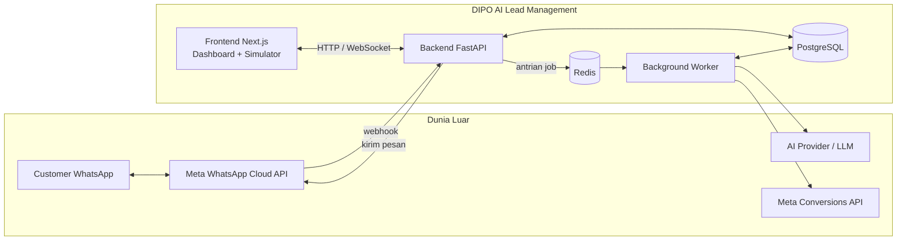
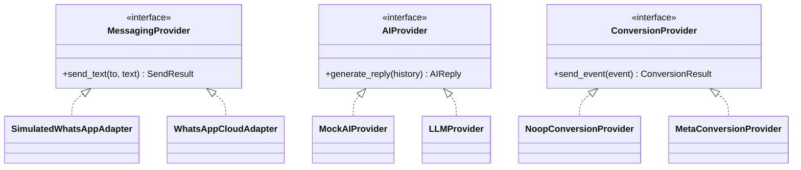
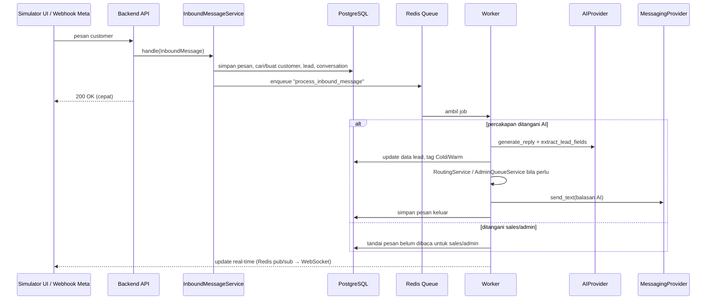
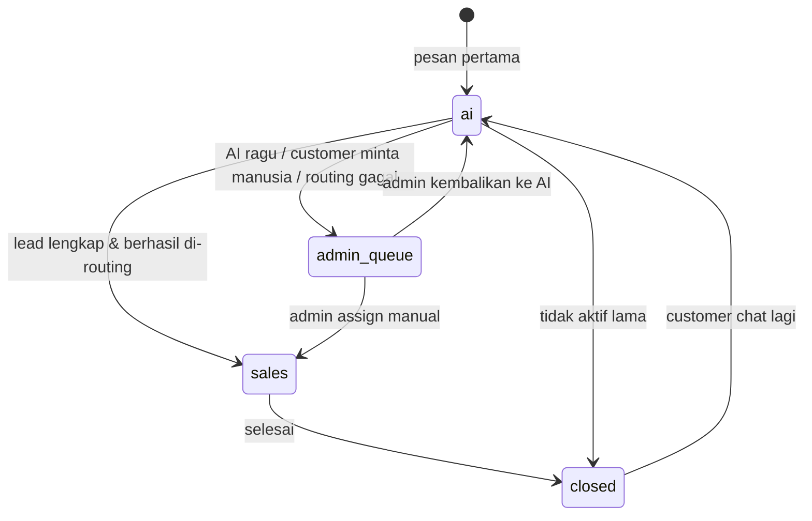

# Arsitektur Sistem — DIPO AI Lead Management

Dokumen ini menjelaskan **bagaimana bagian-bagian sistem saling terhubung**.
Ditulis dengan bahasa sederhana; istilah teknis dijelaskan saat pertama muncul.

---

## 1. Gambaran Besar



Dalam **Development Mode**, kotak *Meta WhatsApp Cloud API* dan *Meta Conversions API*
digantikan oleh simulator dan pencatat log — tidak ada koneksi ke Meta sama sekali.

## 2. Komponen & Fungsinya

| Komponen | Fungsi (bahasa sederhana) |
|----------|---------------------------|
| **Frontend (Next.js)** | Tampilan yang dibuka di browser: dashboard admin, inbox sales, Admin Queue, dan halaman **simulator** chat mirip WhatsApp. |
| **Backend (FastAPI)** | "Otak penerima": menerima permintaan dari frontend dan webhook WhatsApp, menyimpan data, lalu menitipkan pekerjaan berat ke worker. |
| **Background Worker** | "Pekerja di belakang layar": memanggil AI, mengirim pesan, menghitung routing, mengirim conversion event — tanpa membuat backend lambat. |
| **PostgreSQL** | Database utama: customer, lead, percakapan, pesan, sales, riwayat. |
| **Redis** | Penyimpanan cepat untuk antrian pekerjaan (job queue), *pub/sub* untuk update real-time, dan *rate limit*. |
| **WhatsApp Provider (adapter)** | Penghubung ke WhatsApp. Ada dua versi: **Simulated** (dev) dan **Cloud API** (produksi). |
| **AI Provider (adapter)** | Penghubung ke AI. Ada **Mock** (jawaban tetap, untuk test) dan **LLM sungguhan**. |
| **Conversion Provider (adapter)** | Pengirim event konversi ke Meta untuk iklan. Ada **No-op** (dev, hanya log) dan **Meta CAPI** (produksi). |

## 3. Lapisan di Dalam Backend

```
api/v1/ (endpoint, webhook, simulator)   ← hanya menerima & memvalidasi input, cek login/role
        │
        ▼
services/ (BUSINESS LOGIC)               ← satu-satunya tempat aturan bisnis + query database
        │
   ┌────┴──────────────┐
   ▼                   ▼
models/ (SQLAlchemy)  adapters/          ← tabel database | akses sistem luar
   │                   │
   ▼                   ▼
PostgreSQL        WhatsApp / AI / Conversion
```

Catatan: folder `repositories/` dari rencana awal **tidak dipakai**. Query database
ditulis langsung di service agar struktur lebih sederhana.

| Folder | Isi |
|--------|-----|
| `app/core/` | konfigurasi & pengaman, database, Redis, logging, error, keamanan (JWT/bcrypt), `AppContext` |
| `app/models/` | 15 tabel (lihat `DATABASE_DESIGN.md`) |
| `app/schemas/` | bentuk data request/response (Pydantic) |
| `app/services/` | business logic |
| `app/adapters/` | WhatsApp (simulated, cloud), AI (mock) |
| `app/workers/` | antrian job (ARQ / inline) & worker |
| `app/api/v1/` | endpoint HTTP |
| `app/scripts/seed.py` | data dummy |

Service yang **sudah ada** (Phase 1):

| Service | Tanggung jawab |
|---------|----------------|
| `InboundMessageService` | Satu pintu untuk **semua** pesan masuk (webhook & simulator): kontak, lead, percakapan, simpan pesan, antrekan balasan AI |
| `MessageService` | Simpan pesan masuk (anti-duplikat), kirim pesan keluar lewat adapter aktif, terapkan status `sent/delivered/read/failed` |
| `ConversationService` | Cari/buat percakapan terbuka, mulai percakapan baru |
| `ContactService`, `LeadService` | Cari/buat kontak & lead aktif |
| `AutoReplyService` | Ambil riwayat → AI → kirim balasan (dijalankan worker) |
| `WhatsAppWebhookService` | Proteksi duplikat webhook, parsing, teruskan ke service di atas |
| `SimulatorService` | Lapisan tipis: membuat `InboundMessage`/`StatusUpdate` palsu lalu memanggil service yang sama |
| `AuthService`, `UserService` | Login, pembuatan user (+ agent profile untuk sales) |
| `record_audit` | Menulis `audit_logs` |

Service yang **direncanakan**: `LeadQualificationService`, `LeadTaggingService`,
`RoutingService`, `AdminQueueService`, `ConversionEventService`.

## 4. Adapter Pattern

*Adapter pattern* = membuat satu "colokan standar" (interface), lalu menyediakan
beberapa "steker" yang bisa ditukar. Business logic hanya mengenal colokan standarnya,
sehingga tidak peduli apakah pesan dikirim ke simulator atau ke WhatsApp asli.



Parsing webhook (`parse_webhook`) dan validasi signature (`verify_signature`) ada di
`adapters/whatsapp/cloud.py` sebagai fungsi murni sehingga bisa diuji dengan payload dummy.
`send_template` (template message) menyusul saat aktivasi WhatsApp Cloud API.

Adapter dipilih **satu kali** saat aplikasi start, berdasarkan konfigurasi
(`WHATSAPP_PROVIDER`, `AI_PROVIDER`, `CONVERSION_PROVIDER`).

**Simulated adapter** tidak mengirim ke mana pun: pesan keluar disimpan ke database
(sama seperti produksi) lalu disiarkan lewat Redis pub/sub ke halaman simulator.

## 5. Pengaman Development Mode

Tiga lapis pengaman agar Development Mode **tidak mungkin** mengirim pesan sungguhan
atau conversion event produksi:

1. **Validasi saat start (fail fast)** — `app/core/config.py`. Jika `APP_ENV=development`
   tetapi `WHATSAPP_PROVIDER != simulated`, `CONVERSION_PROVIDER != noop`, atau
   `WHATSAPP_CLOUD_SEND_ENABLED=true`, backend dan worker menolak berjalan.
   Production juga diperiksa: simulator wajib mati, `JWT_SECRET` wajib kuat, credential Meta wajib lengkap.
2. **Pengecekan di adapter sungguhan** — `app/core/safety.py`. Tepat sebelum mengirim,
   `WhatsAppCloudAdapter` memastikan `APP_ENV=production` **dan** saklar
   `WHATSAPP_CLOUD_SEND_ENABLED=true`. Jika tidak, pengiriman dibatalkan dan pesan
   disimpan berstatus `failed` dengan alasan yang jelas.
3. **Tanpa credential** — `.env` development tidak berisi token Meta.

Tambahan:
- Endpoint `/api/v1/simulator/*` tidak didaftarkan sama sekali di production.
- Nomor simulator wajib berawalan `+62800` (rentang fiktif).
- Di development semua kontak (termasuk dari webhook dummy) ditandai `is_simulated = true`.
- Di development balasan untuk pesan webhook tetap keluar lewat **simulated adapter**.
- Frontend (phase berikutnya) menampilkan banner **DEVELOPMENT MODE**.

## 6. Alur Pesan Masuk (sama untuk simulator & produksi)



Perbedaan simulator vs produksi **hanya** pada:
- Sumber pesan: tombol "kirim" di simulator vs webhook Meta.
- `MessagingProvider` yang dipakai untuk membalas.

## 7. Siklus Hidup Lead & Percakapan

**Status percakapan (`conversations.handler`):**



**Tag lead (`leads.temperature`):** `cold` → `warm` (aturan detail ditetapkan di Fase 5).
Contoh awal aturan:
- **Cold:** baru tanya-tanya umum, data belum lengkap, atau tidak merespons.
- **Warm:** nama + domisili + unit sudah lengkap **dan** ada sinyal minat
  (tanya harga/kredit/DP, minta test drive, minta dihubungi sales).

## 8. Deployment (rencana)

```
VPS
└── Docker Compose
    ├── nginx      (HTTPS, reverse proxy, port 443)
    ├── frontend   (Next.js)
    ├── backend    (FastAPI / uvicorn)
    ├── worker     (background worker)
    ├── postgres   (volume persisten + backup harian)
    └── redis
```

Secret di VPS disimpan di file `.env` di server (tidak pernah di Git).

## 9. Keputusan yang Masih Terbuka

| Topik | Pilihan | Diputuskan di |
|-------|---------|---------------|
| Library worker | ✅ **ARQ** (ringan, async, memakai Redis) | Phase 1 |
| AI provider LLM | Ditentukan pemilik project | Phase 2 |
| Real-time | WebSocket atau SSE | Phase 5 |
| Autentikasi | ✅ JWT (header Bearer atau cookie httpOnly) + RBAC | Phase 1 |
