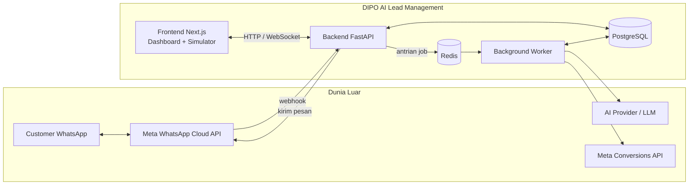
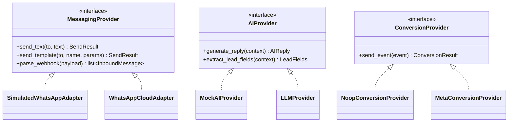
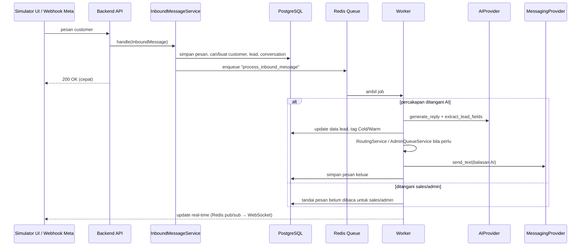
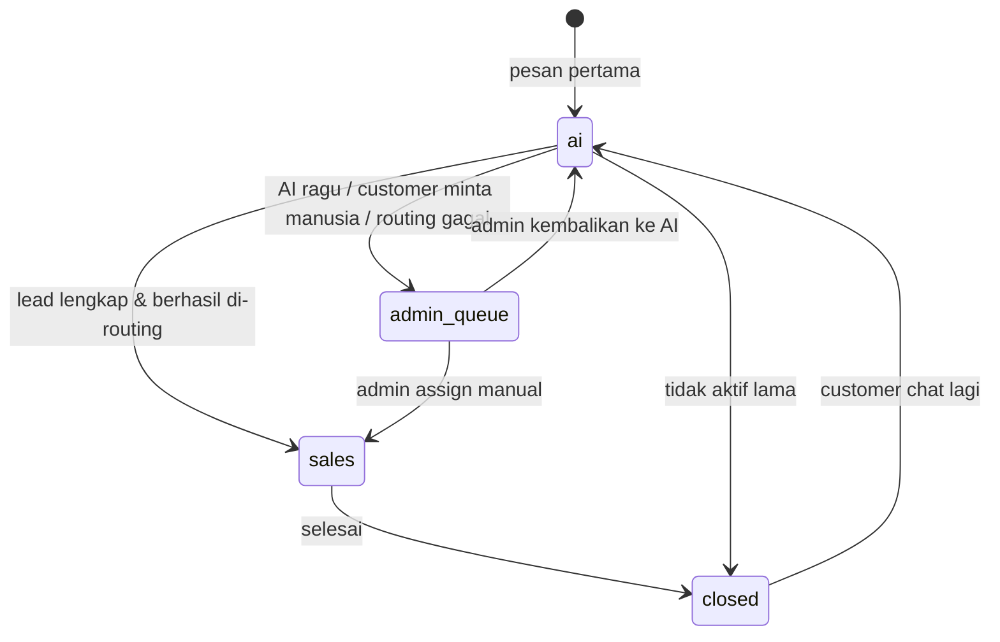

# Arsitektur Sistem — DIPO AI Lead Management

Dokumen ini menjelaskan **bagaimana bagian-bagian sistem saling terhubung**.
Ditulis dengan bahasa sederhana; istilah teknis dijelaskan saat pertama muncul.

---

## 1. Gambaran Besar



Dalam **Development Mode**, kotak *Meta WhatsApp Cloud API* dan *Meta Conversions API*
digantikan oleh simulator dan pencatat log — tidak ada koneksi ke Meta sama sekali.

## 2. Komponen & Fungsinya

| Komponen | Fungsi (bahasa sederhana) |
|----------|---------------------------|
| **Frontend (Next.js)** | Tampilan yang dibuka di browser: dashboard admin, inbox sales, Admin Queue, dan halaman **simulator** chat mirip WhatsApp. |
| **Backend (FastAPI)** | "Otak penerima": menerima permintaan dari frontend dan webhook WhatsApp, menyimpan data, lalu menitipkan pekerjaan berat ke worker. |
| **Background Worker** | "Pekerja di belakang layar": memanggil AI, mengirim pesan, menghitung routing, mengirim conversion event — tanpa membuat backend lambat. |
| **PostgreSQL** | Database utama: customer, lead, percakapan, pesan, sales, riwayat. |
| **Redis** | Penyimpanan cepat untuk antrian pekerjaan (job queue), *pub/sub* untuk update real-time, dan *rate limit*. |
| **WhatsApp Provider (adapter)** | Penghubung ke WhatsApp. Ada dua versi: **Simulated** (dev) dan **Cloud API** (produksi). |
| **AI Provider (adapter)** | Penghubung ke AI. Ada **Mock** (jawaban tetap, untuk test) dan **LLM sungguhan**. |
| **Conversion Provider (adapter)** | Pengirim event konversi ke Meta untuk iklan. Ada **No-op** (dev, hanya log) dan **Meta CAPI** (produksi). |

## 3. Lapisan di Dalam Backend

```
api/ (endpoint, webhook, simulator)     ← hanya menerima & memvalidasi input
        │
        ▼
services/ (BUSINESS LOGIC)              ← satu-satunya tempat aturan bisnis
        │
   ┌────┴──────────────┐
   ▼                   ▼
repositories/      adapters/            ← akses database | akses sistem luar
   │                   │
   ▼                   ▼
PostgreSQL        WhatsApp / AI / Conversion
```

Service utama yang direncanakan:

| Service | Tanggung jawab |
|---------|----------------|
| `InboundMessageService` | Satu pintu untuk **semua** pesan masuk (dari webhook maupun simulator). Simpan pesan, cari/buat customer & percakapan, kirim job ke worker. |
| `ConversationService` | Mengatur status percakapan: ditangani AI, menunggu admin, ditangani sales, selesai. |
| `LeadQualificationService` | Bersama AI mengumpulkan **nama, domisili, unit**, dan menyimpan hasilnya. |
| `LeadTaggingService` | Menentukan tag **Cold/Warm** berdasarkan aturan yang jelas. |
| `RoutingService` | Memilih sales yang tepat (berdasarkan area & beban kerja). |
| `AdminQueueService` | Mengelola antrian kasus yang butuh campur tangan admin. |
| `OutboundMessageService` | Mengirim balasan (AI/sales/admin) lewat `MessagingProvider` yang aktif. |
| `ConversionEventService` | Mencatat dan mengirim conversion event lewat `ConversionProvider`. |

## 4. Adapter Pattern

*Adapter pattern* = membuat satu "colokan standar" (interface), lalu menyediakan
beberapa "steker" yang bisa ditukar. Business logic hanya mengenal colokan standarnya,
sehingga tidak peduli apakah pesan dikirim ke simulator atau ke WhatsApp asli.



Adapter dipilih **satu kali** saat aplikasi start, berdasarkan konfigurasi
(`WHATSAPP_PROVIDER`, `AI_PROVIDER`, `CONVERSION_PROVIDER`).

**Simulated adapter** tidak mengirim ke mana pun: pesan keluar disimpan ke database
(sama seperti produksi) lalu disiarkan lewat Redis pub/sub ke halaman simulator.

## 5. Pengaman Development Mode

Tiga lapis pengaman agar Development Mode **tidak mungkin** mengirim pesan sungguhan
atau conversion event produksi:

1. **Validasi saat start (fail fast).** Jika `APP_ENV=development` tetapi
   `WHATSAPP_PROVIDER != simulated` atau `CONVERSION_PROVIDER != noop`,
   aplikasi menolak berjalan dan menampilkan pesan error.
2. **Pengecekan di dalam adapter produksi.** `WhatsAppCloudAdapter` dan
   `MetaConversionProvider` mengecek ulang `APP_ENV == "production"` tepat sebelum
   mengirim. Jika tidak, pengiriman dibatalkan dan dicatat sebagai error.
3. **Tanpa credential.** File `.env` development tidak berisi token Meta.
   Tanpa token, panggilan ke Meta pasti gagal.

Tambahan:
- Endpoint `/api/v1/simulator/*` hanya terdaftar bila `SIMULATOR_ENABLED=true`;
  di production nilai ini dipaksa `false`.
- Customer dummy diberi penanda `is_simulated = true` di database.
- Frontend menampilkan banner **DEVELOPMENT MODE** yang tidak bisa ditutup.

## 6. Alur Pesan Masuk (sama untuk simulator & produksi)



Perbedaan simulator vs produksi **hanya** pada:
- Sumber pesan: tombol "kirim" di simulator vs webhook Meta.
- `MessagingProvider` yang dipakai untuk membalas.

## 7. Siklus Hidup Lead & Percakapan

**Status percakapan (`conversations.handler`):**



**Tag lead (`leads.temperature`):** `cold` → `warm` (aturan detail ditetapkan di Fase 5).
Contoh awal aturan:
- **Cold:** baru tanya-tanya umum, data belum lengkap, atau tidak merespons.
- **Warm:** nama + domisili + unit sudah lengkap **dan** ada sinyal minat
  (tanya harga/kredit/DP, minta test drive, minta dihubungi sales).

## 8. Deployment (rencana)

```
VPS
└── Docker Compose
    ├── nginx      (HTTPS, reverse proxy, port 443)
    ├── frontend   (Next.js)
    ├── backend    (FastAPI / uvicorn)
    ├── worker     (background worker)
    ├── postgres   (volume persisten + backup harian)
    └── redis
```

Secret di VPS disimpan di file `.env` di server (tidak pernah di Git).

## 9. Keputusan yang Masih Terbuka

| Topik | Pilihan | Diputuskan di |
|-------|---------|---------------|
| Library worker | ARQ / RQ / Celery (rekomendasi awal: **ARQ**, ringan & async) | Fase 1 |
| AI provider LLM | Ditentukan pemilik project | Fase 4 |
| Real-time | WebSocket atau SSE | Fase 8 |
| Autentikasi | JWT di cookie httpOnly | Fase 7 |
