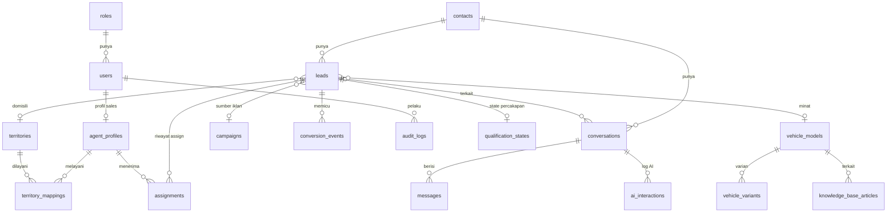

# Rancangan Database — DIPO AI Lead Management

Database: **PostgreSQL 16**. Model: **SQLAlchemy 2.x** (`backend/app/models/`).
Perubahan skema: **Alembic** (`backend/alembic/versions/`).

> **Status:** 20 tabel. Phase 1: migrasi `0001_initial_schema` (15 tabel).
> Phase 2: migrasi `0002_ai_agent_knowledge_base` (5 tabel baru + kolom knowledge base & lead).

## Konvensi

- Primary key: `id` bertipe `UUID`.
- Setiap tabel punya `created_at` dan `updated_at` (`timestamptz`, UTC). Ditampilkan sebagai WIB di API/frontend.
- Nomor telepon dalam format **E.164** (`+628123...`).
- Nilai pilihan (enum) disimpan sebagai `varchar`. Daftar nilainya ada di `app/models/enums.py`.
- Nama constraint dibuat konsisten (`pk_`, `fk_`, `uq_`, `ix_`) agar migrasi mudah diprediksi.
- Data customer asli **tidak pernah** dimasukkan ke seed/test. Nomor simulasi wajib berawalan `+62800`.

## Diagram Relasi

## Tabel

### 1. `roles` — peran pengguna (RBAC)
Diisi otomatis oleh migrasi: `admin`, `supervisor`, `sales`.

| Kolom | Tipe | Keterangan |
|-------|------|------------|
| name | varchar(30) unique | nama peran |
| description | text | penjelasan hak akses |

| Peran | Hak akses (Phase 1) |
|-------|---------------------|
| admin | semua, termasuk membuat user dan reset simulator |
| supervisor | melihat semua percakapan, memakai simulator |
| sales | hanya percakapan yang ditugaskan kepadanya |

### 2. `users` — pengguna dashboard
| Kolom | Tipe | Keterangan |
|-------|------|------------|
| email | varchar(255) unique | untuk login (disimpan huruf kecil) |
| full_name | varchar(120) | |
| password_hash | varchar(255) | hash **bcrypt**, bukan password asli |
| role_id | uuid FK → roles | |
| is_active | bool | user nonaktif tidak bisa login |
| last_login_at | timestamptz | |

### 3. `agent_profiles` — data khusus sales
Dibuat otomatis ketika user ber-role `sales` dibuat.

| Kolom | Tipe | Keterangan |
|-------|------|------------|
| user_id | uuid FK → users, unique | |
| display_name | varchar(120) | nama yang tampil ke customer |
| phone_number | varchar(20) | |
| is_available | bool | sedang bisa menerima lead |
| max_active_leads | int | batas beban kerja |
| last_assigned_at | timestamptz | untuk round-robin |

### 4. `territories` — wilayah/domisili
| Kolom | Tipe | Keterangan |
|-------|------|------------|
| name | varchar(100) unique | mis. "Bekasi" |
| aliases | jsonb | ejaan lain: `["bks", "bekasi kota"]` |
| is_active | bool | |

### 5. `territory_mappings` — sales melayani wilayah mana
| Kolom | Tipe | Keterangan |
|-------|------|------------|
| territory_id | uuid FK → territories | |
| agent_profile_id | uuid FK → agent_profiles | |
| priority | int | semakin kecil semakin diutamakan |

Unik per pasangan (territory, agent).

### 6. `contacts` — customer WhatsApp
| Kolom | Tipe | Keterangan |
|-------|------|------------|
| phone_number | varchar(20) unique | E.164 |
| wa_id | varchar(32) | ID WhatsApp dari Meta |
| display_name | varchar(120) | nama profil / nama dummy |
| is_simulated | bool, index | **true** = data uji (semua kontak di development) |
| opted_out | bool | customer minta berhenti dihubungi; pesan keluar diblokir |

### 7. `campaigns` — campaign tracking
| Kolom | Tipe | Keterangan |
|-------|------|------------|
| name | varchar(150) | |
| platform | varchar(30) | `meta`, `google`, `offline` |
| external_campaign_id / external_adset_id / external_ad_id | varchar(64) | ID dari platform iklan |
| utm | jsonb | parameter UTM |
| is_active | bool | |

### 8. `leads` — prospek penjualan
| Kolom | Tipe | Keterangan |
|-------|------|------------|
| contact_id | uuid FK → contacts | |
| campaign_id | uuid FK → campaigns | asal campaign (jika diketahui) |
| full_name | varchar(120) | dikumpulkan AI (phase berikutnya) |
| domicile_raw | varchar(150) | jawaban domisili apa adanya |
| territory_id | uuid FK → territories | hasil pencocokan domisili |
| vehicle_interest | varchar(150) | unit yang diminati (nama model hasil validasi) |
| vehicle_model_id | uuid FK → vehicle_models | model di katalog (Phase 2) |
| temperature | varchar(10) | `cold` · `warm` (default `cold`) |
| status | varchar(20) | `new` · `qualifying` · `qualified` · `assigned` · `contacted` · `won` · `lost` |
| source | varchar(20) | `whatsapp` · `simulator` · `ctwa_ad` (klik iklan WhatsApp) |
| ad_referral | jsonb | data `referral` iklan dari webhook Meta |
| assigned_agent_id | uuid FK → agent_profiles | sales saat ini |
| qualified_at | timestamptz | |
| is_simulated | bool | |

Satu kontak punya satu lead **aktif** (status selain `won`/`lost`).

### 9. `assignments` — riwayat penugasan lead
| Kolom | Tipe | Keterangan |
|-------|------|------------|
| lead_id | uuid FK → leads | |
| agent_profile_id | uuid FK → agent_profiles | |
| assigned_by_type | varchar(10) | `system` · `user` |
| assigned_by_user_id | uuid FK → users | |
| reason | varchar(255) | mis. "territory match: Bekasi" |
| ended_at | timestamptz | saat dipindah ke sales lain |

### 10. `conversations` — satu utas chat
| Kolom | Tipe | Keterangan |
|-------|------|------------|
| contact_id | uuid FK → contacts | |
| lead_id | uuid FK → leads | |
| provider | varchar(20) | `simulated` · `whatsapp_cloud` |
| status | varchar(10) | `open` · `closed` |
| handler | varchar(20) | `ai` · `admin_queue` · `sales` · `admin`. AI hanya membalas bila `ai` |
| assigned_user_id | uuid FK → users | sales/admin pemegang percakapan |
| last_message_at | timestamptz | |
| last_inbound_at | timestamptz | untuk aturan jendela 24 jam WhatsApp |
| unread_count | int | |
| closed_at | timestamptz | |

Satu kontak hanya punya satu percakapan `open`. "Percakapan baru" menutup yang lama.

### 11. `messages` — setiap pesan masuk/keluar
| Kolom | Tipe | Keterangan |
|-------|------|------------|
| conversation_id | uuid FK → conversations | |
| direction | varchar(10) | `inbound` · `outbound` |
| sender_type | varchar(10) | `contact` · `ai` · `sales` · `admin` · `system` |
| sender_user_id | uuid FK → users | bila dikirim manusia |
| provider | varchar(20) | adapter yang dipakai |
| message_type | varchar(20) | `text`, `image`, `interactive`, ... |
| content | text | isi pesan |
| provider_message_id | varchar(128) **unique** | `wamid...` dari Meta atau `sim-...` dari simulator — **pelindung duplikat** |
| status | varchar(15) | masuk: `received`; keluar: `queued` → `sent` → `delivered` → `read`, atau `failed` |
| error_detail | text | alasan gagal |
| raw_payload | jsonb | payload asli pesan masuk |
| sent_at / delivered_at / read_at | timestamptz | waktu setiap status |

Status pesan keluar **tidak pernah mundur** (status `delivered` yang datang terlambat tidak menimpa `read`).

### 12. `knowledge_base_articles` — promo, DP, angsuran, FAQ, dealer, kebijakan
| Kolom | Tipe | Keterangan |
|-------|------|------------|
| title | varchar(200) | |
| category | varchar(50) | `spec` · `price` · `promo` · `dp` · `installment` · `faq` · `dealer` · `policy` |
| content | text | informasi resmi |
| tags | jsonb | |
| vehicle_model_id | uuid FK → vehicle_models | opsional: khusus model tertentu |
| valid_from / valid_until | timestamptz | masa berlaku (mis. promo) |
| status | varchar(15) | `draft` · `approved` · `archived` — **hanya `approved` yang dilihat AI** |
| approved_by_user_id / approved_at | | siapa & kapan menyetujui |
| is_active | bool | |

### 13. `conversion_events` — event konversi iklan
| Kolom | Tipe | Keterangan |
|-------|------|------------|
| lead_id | uuid FK → leads | |
| event_name | varchar(40) | mis. `Lead`, `QualifiedLead` |
| provider | varchar(20) | `noop` · `meta_capi` |
| status | varchar(15) | `pending` · `sent` · `skipped_dev` · `failed` |
| payload | jsonb | data pribadi di-*hash* sesuai ketentuan Meta |
| sent_at | timestamptz | |
| error | text | |

Di development statusnya selalu `skipped_dev` (logika pengirimannya dibangun di phase berikutnya).

### 14. `audit_logs` — jejak audit
| Kolom | Tipe | Keterangan |
|-------|------|------------|
| actor_type | varchar(10) | `user` · `system` · `ai` · `contact` |
| actor_user_id | uuid FK → users | |
| action | varchar(60) | mis. `auth.login`, `user.created`, `lead.created`, `simulator.reset` |
| entity_type | varchar(40) | |
| entity_id | varchar(64) | sengaja tanpa FK agar riwayat tetap ada walau data dihapus |
| data | jsonb | detail tambahan |

### 15. `webhook_events` — catatan mentah webhook
| Kolom | Tipe | Keterangan |
|-------|------|------------|
| source | varchar(20) | `whatsapp_cloud` |
| event_key | varchar(128) unique | SHA-256 dari body webhook — **pelindung duplikat** |
| payload | jsonb | |
| processed_at | timestamptz | |
| error | text | |

### 16. `vehicle_models` — katalog model Mitsubishi (Phase 2)
| Kolom | Tipe | Keterangan |
|-------|------|------------|
| name | varchar(100) unique | mis. "Xpander" |
| category | varchar(50) | `passenger` · `commercial` |
| aliases | jsonb | ejaan lain/typo: `["expander", "xpender"]` |
| description | text | deskripsi resmi (opsional) |
| sort_order | int | |
| status, approved_by_user_id, approved_at | | alur persetujuan |
| is_active | bool | |

### 17. `vehicle_variants` — varian, spesifikasi, harga (Phase 2)
| Kolom | Tipe | Keterangan |
|-------|------|------------|
| vehicle_model_id | uuid FK → vehicle_models | |
| name | varchar(120) | mis. "Ultimate CVT" |
| transmission / fuel_type | varchar(30) | |
| specs | jsonb | `{"Mesin": "1.5L", "Kursi": "7"}` |
| price_otr | numeric(14,0) | harga OTR resmi |
| price_note | varchar(200) | mis. "OTR Medan, Nov 2026" |
| status, approved_by_user_id, approved_at | | alur persetujuan |
| sort_order, is_active | | |

### 18. `qualification_states` — conversation state (Phase 2)
Satu baris per **lead**, sehingga customer yang kembali tidak ditanya ulang.

| Kolom | Tipe | Keterangan |
|-------|------|------------|
| lead_id | uuid FK → leads, unique | |
| conversation_id | uuid FK → conversations | percakapan terakhir |
| stage | varchar(20) | `collecting` · `handed_over` |
| fields | jsonb | `{"name": {"status": "collected", "value": "Andi", "asks": 1}, "domicile": {...}, "vehicle": {...}}` — status: `missing` · `collected` · `declined` |
| history | jsonb | daftar perubahan: `collected`, `correction`, `declined`, `unanswered` |
| last_asked_field | varchar(20) | data yang ditanyakan di balasan terakhir (diputuskan backend) |
| turns | int | jumlah giliran AI |
| consecutive_ai_failures | int | untuk handover `ai_unavailable` |
| handover_reason | varchar(40) | lihat `docs/AI_AGENT.md` |
| completed_at / handed_over_at | timestamptz | |

### 19. `app_settings` — pengaturan yang bisa diedit admin (Phase 2)
| Kolom | Tipe | Keterangan |
|-------|------|------------|
| key | varchar(80) PK | mis. `qualification.closing_message` |
| value | jsonb | nilai (default ada di kode; baris hanya ada bila diubah) |
| description | text | |
| updated_by_user_id | uuid FK → users | |

### 20. `ai_interactions` — log setiap panggilan AI (Phase 2)
| Kolom | Tipe | Keterangan |
|-------|------|------------|
| conversation_id / message_id | uuid FK | |
| provider / model | varchar | `mock`, `anthropic`, `openai` |
| status | varchar(20) | `ok` · `error` · `refusal` |
| ai_output | jsonb | usulan AI (nilai + draft balasan) |
| decision | jsonb | keputusan backend (sumber balasan, pertanyaan, handover, nilai ditolak, angka yang diblokir) |
| input_tokens / output_tokens / latency_ms | int | biaya & kecepatan |
| error | text | |

## Penghapusan Data Simulasi

Foreign key memakai `ON DELETE CASCADE`. Menghapus contact dummy otomatis menghapus
lead, percakapan, pesan, assignment, dan conversion event miliknya. `audit_logs` tetap disimpan.

## Rencana Tabel Berikutnya

| Tabel | Untuk | Phase |
|-------|-------|-------|
| `admin_queue_items` | antrian kasus untuk admin | Admin Queue |

## Catatan Privasi

- Kolom berisi data pribadi: `contacts.phone_number`, `display_name`, `leads.full_name`,
  `messages.content`, `messages.raw_payload`. Akses dibatasi sesuai role.
- Nomor telepon di log aplikasi disamarkan (`+6280******123`).
- Kebijakan retensi (berapa lama data disimpan) diputuskan sebelum go-live.

## Implementasi Phase 3 — Routing

Phase 3 tidak menambah tabel baru. Sistem menggunakan tabel `territories`, `territory_mappings`, `agent_profiles`, `leads`, dan `assignments` yang sudah ada.

- `leads.temperature` hanya menjadi `warm` saat assignment aktif ke profil sales berhasil dipersist.
- `leads.assigned_agent_id` menunjuk agent saat ini; `leads.territory_id` menunjuk wilayah yang cocok secara exact.
- `assignments` menyimpan riwayat; ketika dipindahkan, assignment sebelumnya diberi `ended_at`, lalu baris baru dibuat.
- Lead yang belum lengkap atau tidak bisa dipetakan/ditugaskan tetap `cold`; percakapan diarahkan ke `admin_queue`.
- Wilayah tidak otomatis mencakup kota tetangga. Tambahkan alias/mapping hanya setelah cakupan wilayah dikonfirmasi admin.
