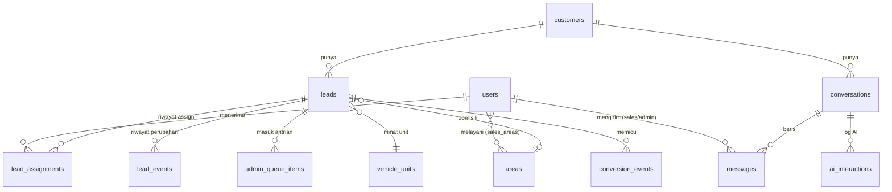

# Rancangan Database — DIPO AI Lead Management

Database: **PostgreSQL**. Model: **SQLAlchemy 2.x**. Perubahan skema: **Alembic**.

> Ini rancangan awal (Fase 0). Detail kolom bisa disesuaikan di Fase 2,
> dan dokumen ini akan diperbarui bersamaan.

## Konvensi

- Primary key: `id` bertipe `UUID`.
- Setiap tabel punya `created_at` dan `updated_at` (`timestamptz`, UTC).
- Nomor telepon format **E.164** (`+628123...`).
- Nilai pilihan (enum) disimpan sebagai `varchar` + validasi di aplikasi,
  agar mudah ditambah tanpa migrasi rumit.
- Data customer asli **tidak pernah** dimasukkan ke seed/test.

## Diagram Relasi

## Tabel

### `users` — pengguna dashboard (admin, sales, supervisor)
| Kolom | Tipe | Keterangan |
|-------|------|------------|
| id | uuid PK | |
| full_name | varchar(120) | |
| email | varchar(255) unique | untuk login |
| password_hash | varchar(255) | hash (bcrypt/argon2), **bukan** password asli |
| role | varchar(20) | `admin` · `sales` · `supervisor` |
| phone_number | varchar(20) null | nomor sales (opsional) |
| is_active | bool | |
| max_active_leads | int null | batas beban kerja sales |
| last_assigned_at | timestamptz null | untuk round-robin |

### `areas` — wilayah/domisili untuk routing
| Kolom | Tipe | Keterangan |
|-------|------|------------|
| id | uuid PK | |
| name | varchar(100) | mis. "Jakarta Selatan" |
| aliases | jsonb | ejaan lain: `["jaksel", "jkt selatan"]` |
| is_active | bool | |

### `sales_areas` — sales melayani area mana (many-to-many)
| Kolom | Tipe | Keterangan |
|-------|------|------------|
| user_id | uuid FK → users | |
| area_id | uuid FK → areas | |
| priority | int | urutan prioritas |

### `vehicle_units` — katalog unit kendaraan
| Kolom | Tipe | Keterangan |
|-------|------|------------|
| id | uuid PK | |
| name | varchar(100) | nama unit |
| category | varchar(50) | mis. `passenger`, `commercial` |
| aliases | jsonb | ejaan/sebutan lain dari customer |
| is_active | bool | |

### `customers` — orang yang chat via WhatsApp
| Kolom | Tipe | Keterangan |
|-------|------|------------|
| id | uuid PK | |
| phone_number | varchar(20) unique | E.164 |
| wa_id | varchar(32) null | ID WhatsApp dari Meta |
| profile_name | varchar(120) null | nama profil WhatsApp |
| is_simulated | bool | **true** untuk customer dummy simulator |
| opted_out | bool | customer minta berhenti dihubungi |

### `leads` — prospek penjualan
| Kolom | Tipe | Keterangan |
|-------|------|------------|
| id | uuid PK | |
| customer_id | uuid FK → customers | |
| full_name | varchar(120) null | nama yang dikumpulkan AI |
| domicile_raw | varchar(150) null | jawaban customer apa adanya |
| area_id | uuid FK → areas null | hasil pencocokan domisili |
| vehicle_unit_raw | varchar(150) null | jawaban customer apa adanya |
| vehicle_unit_id | uuid FK → vehicle_units null | hasil pencocokan unit |
| temperature | varchar(10) | `cold` · `warm` |
| status | varchar(20) | `new` · `qualifying` · `qualified` · `assigned` · `contacted` · `won` · `lost` |
| assigned_sales_id | uuid FK → users null | sales saat ini |
| source | varchar(30) | `whatsapp` · `simulator` · `ctwa_ad` (klik iklan) |
| ad_referral | jsonb null | data iklan dari Meta (jika ada) |
| qualified_at | timestamptz null | saat data lengkap |
| is_simulated | bool | ikut dari customer |

### `conversations` — satu utas chat dengan customer
| Kolom | Tipe | Keterangan |
|-------|------|------------|
| id | uuid PK | |
| customer_id | uuid FK → customers | |
| lead_id | uuid FK → leads null | |
| provider | varchar(20) | `simulated` · `whatsapp_cloud` |
| handler | varchar(20) | `ai` · `admin_queue` · `sales` · `closed` |
| assigned_user_id | uuid FK → users null | sales/admin yang memegang |
| last_message_at | timestamptz | |
| last_inbound_at | timestamptz null | untuk aturan jendela 24 jam WhatsApp |
| unread_count | int | |

### `messages` — setiap pesan masuk/keluar
| Kolom | Tipe | Keterangan |
|-------|------|------------|
| id | uuid PK | |
| conversation_id | uuid FK → conversations | |
| direction | varchar(10) | `inbound` · `outbound` |
| sender_type | varchar(10) | `customer` · `ai` · `sales` · `admin` · `system` |
| sender_user_id | uuid FK → users null | bila dikirim sales/admin |
| message_type | varchar(20) | `text` · `template` · `image` · `interactive` · ... |
| content | text | isi pesan |
| provider_message_id | varchar(128) null unique | ID dari Meta / simulator (anti-duplikat) |
| status | varchar(15) | `queued` · `sent` · `delivered` · `read` · `failed` · `received` |
| error_detail | text null | |
| raw_payload | jsonb null | payload asli (tanpa data rahasia) |

Index: `(conversation_id, created_at)`.

### `lead_assignments` — riwayat penugasan lead ke sales
| Kolom | Tipe | Keterangan |
|-------|------|------------|
| id | uuid PK | |
| lead_id | uuid FK → leads | |
| sales_id | uuid FK → users | |
| assigned_by | varchar(10) | `system` · `admin` |
| assigned_by_user_id | uuid FK → users null | |
| reason | varchar(255) | mis. "area match: Jakarta Selatan" |
| ended_at | timestamptz null | saat dipindah ke sales lain |

### `lead_events` — jejak audit perubahan lead
| Kolom | Tipe | Keterangan |
|-------|------|------------|
| id | uuid PK | |
| lead_id | uuid FK → leads | |
| event_type | varchar(40) | `field_collected` · `temperature_changed` · `status_changed` · `assigned` · `queued` · ... |
| old_value | jsonb null | |
| new_value | jsonb null | |
| actor_type | varchar(10) | `ai` · `system` · `user` |
| actor_user_id | uuid FK → users null | |

### `admin_queue_items` — antrian kasus untuk admin
| Kolom | Tipe | Keterangan |
|-------|------|------------|
| id | uuid PK | |
| lead_id | uuid FK → leads | |
| conversation_id | uuid FK → conversations | |
| reason | varchar(30) | `routing_failed` · `human_requested` · `ai_low_confidence` · `complaint` · `other` |
| note | text null | |
| priority | int | semakin kecil semakin penting |
| status | varchar(15) | `open` · `in_progress` · `resolved` |
| claimed_by_user_id | uuid FK → users null | |
| resolved_at | timestamptz null | |

### `ai_interactions` — log panggilan AI (untuk evaluasi & biaya)
| Kolom | Tipe | Keterangan |
|-------|------|------------|
| id | uuid PK | |
| conversation_id | uuid FK → conversations | |
| message_id | uuid FK → messages null | pesan yang memicu |
| provider | varchar(30) | `mock` · nama provider LLM |
| model | varchar(60) | |
| extracted_fields | jsonb | hasil ekstraksi nama/domisili/unit |
| confidence | numeric(3,2) null | |
| input_tokens / output_tokens | int null | |
| latency_ms | int | |
| error | text null | |

### `conversion_events` — event konversi untuk Meta
| Kolom | Tipe | Keterangan |
|-------|------|------------|
| id | uuid PK | |
| lead_id | uuid FK → leads | |
| event_name | varchar(40) | mis. `Lead`, `QualifiedLead` |
| provider | varchar(20) | `noop` · `meta_capi` |
| status | varchar(15) | `pending` · `sent` · `skipped_dev` · `failed` |
| payload | jsonb | data yang dikirim (data pribadi di-*hash*) |
| sent_at | timestamptz null | |

Di Development Mode status selalu `skipped_dev`.

### `webhook_events` — catatan mentah webhook (untuk debug & anti-duplikat)
| Kolom | Tipe | Keterangan |
|-------|------|------------|
| id | uuid PK | |
| source | varchar(20) | `whatsapp_cloud` · `simulator` |
| event_key | varchar(128) unique | kunci idempotensi |
| payload | jsonb | |
| processed_at | timestamptz null | |
| error | text null | |

## Catatan Privasi

- Kolom berisi data pribadi: `customers.phone_number`, `profile_name`,
  `leads.full_name`, `messages.content`. Akses dibatasi sesuai role.
- Payload conversion event: nomor telepon di-*hash* SHA-256 sesuai ketentuan Meta.
- Kebijakan retensi (berapa lama data disimpan) diputuskan sebelum go-live.
